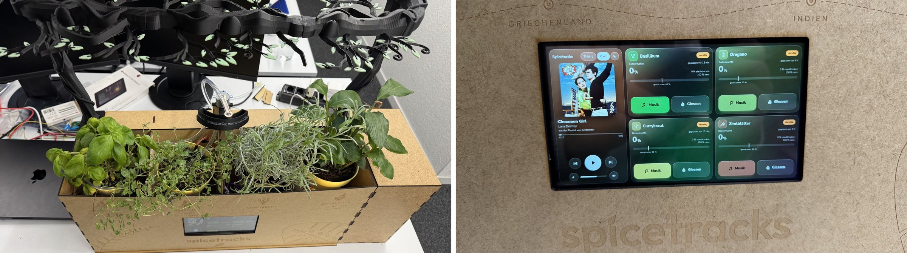

# Spicetracks

Eine Kräuterbox mit vier Pflanzen, die gleichzeitig Musik abspielt. Entstanden ist sie als Projekt von Gruppe 4 im Kurs "Hands-on HCI: Entwicklung von Software- und Hardware-Prototypen" an der Universität St. Gallen im Herbstsemester 2026.

Berührt man eines der Kräuter, startet die Spotify-Playlist dieser Pflanze. Über den Töpfen hängt ein 3D-gedruckter Ast mit LEDs. Läuft Musik, zeigt er sie als Equalizer an, ist es still, zeigt er, wie es den Pflanzen geht. Die Box misst ausserdem die Feuchte in jedem Topf und giesst selbst: Eine einzige Pumpe versorgt alle vier Pflanzen, ein schwenkbarer Arm bringt das Wasser zum richtigen Topf.

Technisch steckt ein ESP32-S3 dahinter, der die Sensoren und Aktoren steuert, und ein Raspberry Pi mit Display, auf dem die Logik, Spotify und die Bedienoberfläche laufen.

## Team

Thierry Suhner, Lukas Kapferer, Phil Solenthaler, Karla Ruggaber

## Video

Video: _Link folgt_

## Inhalt

| Ordner | Inhalt |
| --- | --- |
| `software/firmware/` | Firmware für den ESP32-S3 (Arduino/C++): Sensoren, Pumpe, Motor, LEDs, Touch-Erkennung |
| `software/pi/` | Programm für den Raspberry Pi (Python): Logik, Spotify, Equalizer, Weboberfläche, NFC-Profile |
| `software/README.md` | Ausführliche Anleitung zum Einrichten, Testen und Deployen |
| `tests/` | Gesamttest der Hardware am Laptop, ohne Pi |
| `hardware/steckplan/` | Steckplan mit Kabelliste als HTML (interaktiv) und PDF |
| `hardware/laser/` | Schnittdateien für den Lasercutter (SVG) und Laserplan |
| `hardware/3d-druck/` | Druckdateien für Ast, Stämme, Füsse und Triebe (STL, 3MF) und Druckplan |
| `docs/skizzen/` | Skizzen und Entwürfe aus der Ideenphase |
| `docs/abbildungen/` | Abbildungen aus dem Projektbericht |
| `docs/fotos/` | Fotos aus dem Entstehungsprozess |

## Nachbau in Kürze

1. Gehäuse aus den SVG-Dateien in `hardware/laser/` lasern und zusammenstecken, Ast in drei Teilen drucken.
2. Elektronik nach dem Steckplan in `hardware/steckplan/` stecken, nur ohne Strom. Die roten Schienen der beiden Breadboards nie verbinden und die gemeinsame Masse nicht vergessen.
3. Firmware aus `software/firmware/spicetracks_esp32/` mit der Arduino IDE auf den ESP32-S3 laden (Board "ESP32S3 Dev Module", Bibliotheken Adafruit NeoPixel und ArduinoJson 7).
4. Auf dem Pi das Python-Programm aus `software/pi/` installieren, eine Spotify-App anlegen und Playlists sowie Grenzwerte in `config.yaml` eintragen.
5. Feuchtesensoren kalibrieren und die Teile einzeln mit dem Testmenü (`python -m spicetracks.hwtest`) prüfen.

Die genauen Schritte stehen in [`software/README.md`](software/README.md).

## Nicht im Repository

- **Spotify-Zugangsdaten:** Client-ID und Secret gehören in `~/.config/spicetracks.env` auf dem Pi, eine Vorlage liegt in `software/pi/systemd/spicetracks.env.example`. Der Login-Token (`.spotify_token`) entsteht beim ersten Start und wird nie hochgeladen.
- **Videos und Rohaufnahmen:** Sie sind zu gross für GitHub. Das finale Video ist oben verlinkt.
